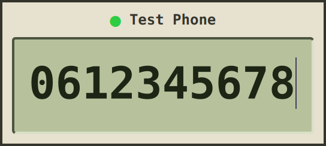

# leansip

A minimal, agent-friendly Linux SIP client.

 

Run `leansip` to open the dialer. Type a number and press Enter to call; Esc hangs up. When
someone calls you, the window comes to the front and you answer with Enter. Digits typed during
a call go out as DTMF and `m` mutes the microphone. Ctrl+0 to Ctrl+9 switch to the account
(profile) that has that digit as its `shortcut`, and `?` lists all keys.

## Why not just baresip?

leansip uses [baresip](https://github.com/baresip/baresip) for SIP and audio, and adds:

- All accounts are profiles in one config file, instead of one baresip config directory per
  account.
- `leansip 0612345678` opens a window and dials, and `tel:` links open in leansip.
- A small graphical dialer, where baresip has a console menu.
- A daemon per profile with a control command, `leansipctl`, that agents and scripts use to
  automate calls and run end-to-end tests of phone services.

## The user interface

Leansip can be started with a number to directly dial it. It supports multiple profiles (SIP accounts).

```
leansip                    # open the dialer for the default profile
leansip 0612345678         # open and dial
leansip tel:+31201234567   # tel: and sip: URIs work; leansip handles tel: links
leansip -p work            # another profile, in its own window
leansip --record           # record calls
```

The window has no frame and is driven from the keyboard; drag it anywhere to move it. During a
call the LCD shows the last second of the far end's voice as bars that spread out from the
centre. Your own microphone level sits small in the top right corner, replaced by `MUTE` while
you are muted. `+N CALLS` means an agent has calls of its own.

An incoming call brings the window to the front and flashes it amber until you answer (Enter)
or decline (Esc). Starting a second `leansip` for the same profile passes its number to the
window that is already open.

| Key          | Action                                                   |
|--------------|----------------------------------------------------------|
| `0-9 * # +`  | type a number; DTMF during a call                        |
| `Enter`      | call · answer                                            |
| `Esc`        | hang up · decline · clear · quit when empty              |
| `↑`          | recall the last number                                   |
| `m`          | mute · unmute the microphone                             |
| `Alt+0-9`    | fill in that phonebook number (Enter dials it)           |
|              | with a typed number: save it there (Enter: all profiles, Alt+Enter: this one) |
| `Ctrl+0-9`   | switch to the profile with that `shortcut`               |
| `?` / `F1`   | help                                                     |
| `Ctrl+Q`     | quit                                                     |

## Agents: leansipctl

`leansipctl` lets coding agents and scripts make and answer real phone calls from the command
line: dial, send DTMF, talk into the call, get a transcript of what the other side says, record
it, and ask afterwards what went wrong. `start` brings the SIP account up in the background and
the other commands act on its calls until `stop`. The dialer uses the same account and sees the
same calls, so you can follow what an agent is doing and step in or hang up. The script below
calls an IVR, waits for it to answer, listens to the greeting, replies, presses 1, hangs up and
asks for an analysis of the call:

```bash
leansipctl start --record                          # bring up the SIP account (profile)
r=$(leansipctl dial 940)                           # {"ok":true,"seq":12,"call":"35fa…",...}
call=$(echo "$r" | jq -r .call)
leansipctl wait CALL_ESTABLISHED,CALL_CLOSED --call "$call" --since "$(echo "$r" | jq .seq)"
leansipctl listen --call "$call"                   # {"text":"Welcome to …","seconds":3.2,...}
leansipctl say "I'd like to speak to support" --call "$call" --wait
leansipctl dtmf 1 --call "$call"
leansipctl hangup --call "$call"
leansipctl analyze --call "$call"                  # timing, codec, RTCP, levels, warnings
leansipctl stop
```

Output is one JSON object per line on stdout. Exit codes are fixed: 0 ok, 1 failed or timed
out, 2 usage error, 3 not running. `leansipctl help <command>` documents each command.

Every reply carries a sequence number. Pass it to `wait --since <seq>` and the wait also sees
events that fired before it started, so there is no race between dialing and waiting.
`events --follow` streams events as they happen.

`say` speaks text into the call and `listen` returns a transcript of the far end's next
utterance; `transcribe` does the same for a WAV file. These use ElevenLabs and need
`ELEVENLABS_API_KEY`.

`start --record` keeps both directions of each call as WAV files. `analyze` reports answer
time, codec, packet loss, jitter and audio levels, and warns about one-way audio and similar
problems. `start --sip-trace` logs every SIP message.

Each profile (one SIP account) runs on its own; pick one with `-p NAME`. `leansipctl profiles`
lists them without passwords.

Every dial is a real call, so there are limits:

- Calls an agent places or answers hang up after 10 minutes (`--max-call-seconds`).
- A profile with `confirm_dial = true` (a real trunk, for example) dials only with `--yes`.
- Commands target a call by id (`--call`), so an agent never acts on the call you have open.

Full reference: [docs/leansipctl.md](docs/leansipctl.md).

## Install

Each release has a `.deb` and a `.tar.gz` for x86-64 Linux. They are built on Ubuntu 26.04
and need Qt 6.10 or newer. SIP and audio are done by
[baresip](https://github.com/baresip/baresip) 1.1.0 or newer, which the `.deb` installs.

```
sudo apt install ./leansip_<version>_amd64.deb
```

With the tarball you install baresip and Qt yourself. `SHA256SUMS` has the checksums, and
`gh attestation verify <file> --repo arjan/leansip` checks that a file was built by this
repository's release workflow.

## Configuration

Accounts are profiles in `~/.config/leansip/leansip.toml`. The file may hold passwords, so it
must be private (`chmod 600`).

```toml
default_profile = "desk"

[phonebook]                            # Alt+<digit> fills in the number; Enter dials
1 = "0612345678"
2 = "sip:helpdesk@pbx.example.com"

[profiles.desk]
label = "Desk"                         # the name shown in the dialer
shortcut = 1                           # Ctrl+1 switches the dialer to it
aor = "sip:phone1@pbx.example.com"
password_cmd = "rbw get sip-desk"      # or: password = "..."

[profiles.trunk]
aor = "sip:4420@trunk.example.net"
password_cmd = "rbw get sip-trunk"
confirm_dial = true                    # leansipctl dial needs --yes
```

Most profiles need only `aor` and a password. All options, including audio and codec
settings, are in [docs/configuration.md](docs/configuration.md).

## Building / development

```
sudo apt install build-essential cmake ninja-build qt6-base-dev libtomlplusplus-dev baresip-core
cmake -S . -B build -G Ninja -DCMAKE_BUILD_TYPE=Release
cmake --build build
ctest --test-dir build --output-on-failure
./build/src/leansip
```

Building needs Qt 6.4 or newer. Running needs baresip 1.1.0 or newer: Ubuntu 26.04 has it,
but 24.04 ships 1.0.0, which is too old. `sudo cmake --install build` installs leansip, and
`cpack` in the build directory makes the release packages.
[docs/architecture.md](docs/architecture.md) explains how the parts fit together and how to
cut a release.

## License

BSD 3-Clause; see [LICENSE](LICENSE).
