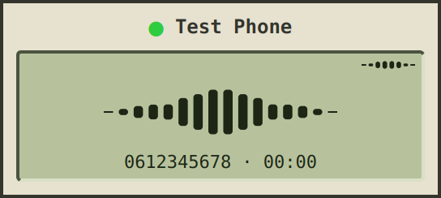

# leansip

A minimal, agent-friendly Linux SIP client.

Coding agents and scripts place, answer and drive real phone calls with `leansipctl`: dial,
send DTMF, speak into the call, transcribe what the other side says, record, and get a
diagnosis of the call afterwards. Every command prints JSON. A small keyboard-driven dialer
shares the same calls, so you can watch, join or hang up what an agent is doing.



## Agents: leansipctl

```bash
leansipctl start --record                          # bring up the SIP account (profile)
r=$(leansipctl dial 940)                           # {"ok":true,"seq":12,"call":"35fa…",...}
call=$(echo "$r" | jq -r .call)
leansipctl wait CALL_ESTABLISHED,CALL_CLOSED --call "$call" --since "$(echo "$r" | jq .seq)"
leansipctl listen --call "$call"                   # {"text":"Welcome to …","seconds":3.2,...}
leansipctl say "I'd like to speak to support" --call "$call" --wait
leansipctl dtmf 1 --call "$call"
leansipctl hangup --call "$call"
leansipctl analyze --call "$call"                  # timing, codec, RTCP, levels, warnings
leansipctl stop
```

What an agent gets:

- **One JSON object per line** on stdout, stable exit codes (0 ok, 1 failed or timed out,
  2 usage, 3 not running) and `leansipctl help <command>` for every command.
- **Events without races.** Every reply carries a sequence number; `wait --since <seq>` never
  misses an event that fired before it started. `events --follow` streams them.
- **Speech.** `say` speaks text into the call, `listen` returns a transcript of the far end's
  next utterance, `transcribe` does a WAV file. Uses ElevenLabs (`ELEVENLABS_API_KEY`).
- **Recording and analysis.** `start --record` keeps both directions as WAV; `analyze` reports
  answer time, codec, packet loss and jitter, audio levels, one-way audio and other warnings.
- **SIP traces.** `start --sip-trace` logs every SIP message.
- **Several accounts.** Each profile runs separately (`-p NAME`); `leansipctl profiles` lists
  them, never showing passwords.

Guard rails, because every dial is a real call:

- Calls an agent places or answers hang up after 10 minutes (`--max-call-seconds`).
- A profile with `confirm_dial = true`, for a real trunk say, dials only with `--yes`.
- Commands target a call by id (`--call`), so an agent never acts on the call you have open.

Full reference: [docs/leansipctl.md](docs/leansipctl.md).

## The dialer

```
leansip                    # open the dialer for the default profile
leansip 0612345678         # open and dial
leansip tel:+31201234567   # tel: and sip: URIs work; leansip handles tel: links
leansip -p work            # another profile, in its own window
leansip --record           # record calls
```

The window is frameless and keyboard driven; drag anywhere to move it. During a call the LCD
shows the far end's voice as bars spreading out from the centre, the last second of it, and
your microphone small in the corner (`MUTE` in its place while muted); `+N CALLS` means an agent
has calls of its own. An incoming call brings the window to the front and flashes it amber
until you answer (Enter) or decline (Esc). A second `leansip` for the same profile hands its
number to the open window.

| Key          | Action                                                   |
|--------------|----------------------------------------------------------|
| `0-9 * # +`  | type a number; DTMF during a call                        |
| `Enter`      | call · answer                                            |
| `Esc`        | hang up · decline · clear · quit when empty              |
| `↑`          | recall the last number                                   |
| `m`          | mute · unmute the microphone                             |
| `Ctrl+0-9`   | switch to the profile with that `shortcut`               |
| `?` / `F1`   | help                                                     |
| `Ctrl+Q`     | quit                                                     |

## Install

Releases carry a `.deb` and a `.tar.gz` for x86-64 Linux, built on Ubuntu 26.04 (they need Qt 6.10+).
leansip uses [baresip](https://github.com/baresip/baresip) 1.1.0 or newer for SIP
and audio; the `.deb` pulls it in.

```
sudo apt install ./leansip_<version>_amd64.deb
```

With the tarball, install baresip (1.1.0+) and Qt 6 yourself. `SHA256SUMS` has the checksums, and
`gh attestation verify <file> --repo arjan/leansip` checks a file came from this repository's
release workflow.

## Configuration

Accounts are profiles in `~/.config/leansip/leansip.toml`. The file may hold passwords, so it
must be private (`chmod 600`).

```toml
default_profile = "desk"

[profiles.desk]
label = "Desk"                         # the name shown in the dialer
shortcut = 1                           # Ctrl+1 switches the dialer to it
aor = "sip:phone1@pbx.example.com"
password_cmd = "rbw get sip-desk"      # or: password = "..."

[profiles.trunk]
aor = "sip:4420@trunk.example.net"
password_cmd = "rbw get sip-trunk"
confirm_dial = true                    # leansipctl dial needs --yes
```

Every option, audio and codec settings included: [docs/configuration.md](docs/configuration.md).

## Build

```
sudo apt install build-essential cmake ninja-build qt6-base-dev libtomlplusplus-dev baresip-core
cmake -S . -B build -G Ninja -DCMAKE_BUILD_TYPE=Release
cmake --build build
ctest --test-dir build --output-on-failure
./build/src/leansip
```

Building needs Qt 6.4 or newer; running needs baresip 1.1.0 or newer (Ubuntu 26.04 has it,
24.04's 1.0.0 is too old). `sudo cmake --install build` installs it; `cpack` in the build directory makes the release
packages. How the pieces fit together, and how to cut a release:
[docs/architecture.md](docs/architecture.md).

## License

BSD 3-Clause; see [LICENSE](LICENSE).
